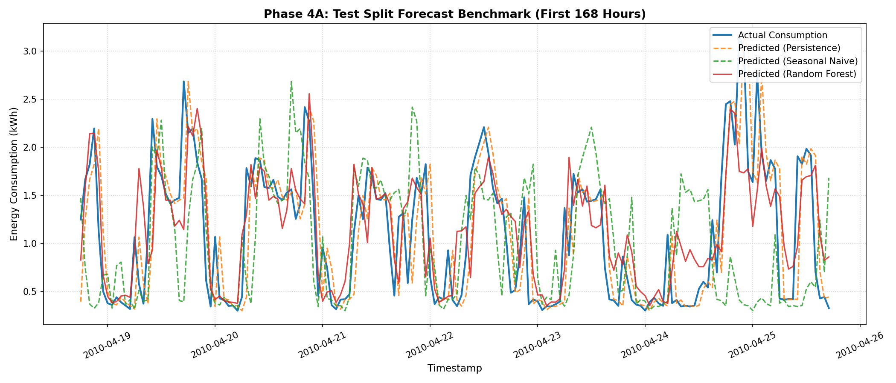
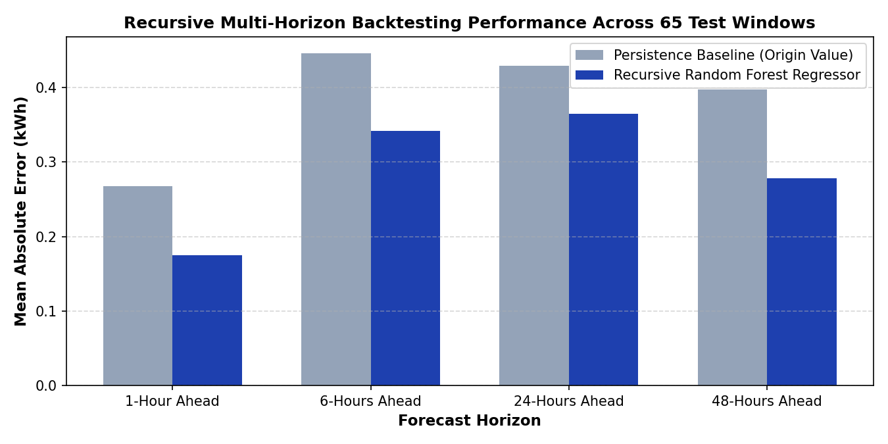

# AI-Powered Energy Consumption Forecasting System

A reproducible, production-grade machine learning forecasting system designed to predict residential electrical load from multivariate time-series data using temporal features, autoregressive lags, recursive multi-step forecasting, and an interactive Streamlit dashboard.

---

## Executive Summary

Power demand volatility presents operational and economic challenges for electrical utilities, microgrid operators, and energy managers. Imbalances between generated supply and consumer demand lead to costly peak-generation dispatch, increased carbon emissions, and grid instability.

This project delivers an end-to-end forecasting pipeline that resamples high-frequency electrical measurements into hourly energy consumption (kilowatt-hours, kWh), applies strict anti-leakage feature engineering, trains a Random Forest ensemble, evaluates performance against standard persistence and seasonal baselines on chronologically held-out observations, and provides an interactive web dashboard for multi-step scenario simulation.

### Key Performance Highlights

- Dataset Scale: 34,143 validated hourly observations spanning December 2006 to November 2010.
- Machine Learning Model: Random Forest Regressor (100 estimators, random_state=42).
- Test Set Mean Absolute Error (MAE): 0.3344 kWh (13.0 percent reduction vs. 1-hour persistence; 34.2 percent reduction vs. 24-hour seasonal naive).
- Test Set Root Mean Squared Error (RMSE): 0.4791 kWh (17.7 percent reduction vs. 1-hour persistence).
- Explained Variance (R-Squared): 0.5390 on held-out test data.
- Multi-Horizon Recursive Rollout: Validated across 1-hour, 6-hour, 24-hour, and 48-hour horizons using a disjoint 72-hour rolling-origin backtest.
- Live Streaming Prediction Engine: Sequential historical replay simulation, next-hour forecasting, and real-time error evaluation.
- Automated Test Suite: 155 passing unit, integration, and UI acceptance tests.

---

## Business Value and Operational Impact

- Peak Demand Shaving: Anticipating residential demand spikes 24 to 48 hours in advance allows energy managers to optimize battery storage dispatch and schedule flexible appliance loads.
- Grid Balancing: Accurate short-term load forecasts assist microgrid controllers in planning renewable generation integration and reducing reliance on fossil-fuel peaker plants.
- Cost Optimization: Enables automated response strategies under time-of-use (TOU) electricity pricing structures.
- Auditability: Every stage of the data pipeline enforces strict chronological splitting and provenance tracking, preventing lookahead leakage.

---

## Dataset Description and Preprocessing Protocol

### Source Dataset
- Source: Individual Household Electric Power Consumption dataset from the official UCI Machine Learning Repository.
- Location: Sceaux, France (suburban single-family residence).
- Recording Period: December 16, 2006 (17:24:00) to November 26, 2010 (21:02:00).
- Raw Observations: 2,075,259 minute-level measurements.

### Preprocessing and Hourly Resampling Policy
Raw measurements report minute-averaged active power in kilowatts (kW). In an hour with 60 fully observed minutes, hourly energy in kilowatt-hours (kWh) equals the mean active power multiplied by 1.0 hour:

Energy (kWh) = Mean(Active Power in kW) * 1.0 hour

1. Timestamp Cleaning: Chronological sorting, duplicate timestamp detection, and deterministic resolution using valid minute averages.
2. Completeness Gating: An hourly interval is accepted only if at least 90 percent of minutes (54 of 60 minutes) contain valid readings. Unobserved minutes within an accepted hour are assumed missing at random and represented by the hour's observed mean.
3. Zero-Filling Rejection: Hours with less than 90 percent valid minutes are excluded entirely (446 intervals excluded across 4 years). Unobserved hours are never treated as zero consumption or synthetically fabricated.
4. Output Schema: Stored in data/processed/hourly_energy.csv with 34,143 hourly records across columns: timestamp, energy_kwh, valid_minutes, coverage_ratio.

---

## System Architecture

```
Raw Minute Measurements (UCI Dataset: 2,075,259 rows)
                    |
                    v
[Data Loader & Cleaner] ---> src/data_loader.py
                    |
                    v
[Hourly Resampling & Coverage Gate] ---> src/preprocessing.py (34,143 hourly rows)
                    |
                    v
[Feature Engineering] ---> src/feature_engineering.py (Calendar, Lags, Rolling Mean)
                    |
                    v
[Chronological Splitting] ---> src/train.py (Train: 70%, Val: 15%, Test: 15%)
                    |
                    +------------------------------------+
                    |                                    |
                    v                                    v
         [Heuristic Baselines]              [Machine Learning Model]
         - Persistence (1h)                 - Random Forest Regressor
         - Seasonal Naive (24h)               (100 trees, 9 features)
                    |                                    |
                    +-----------------+------------------+
                                      |
                                      v
[Standardized Evaluation Benchmark] ---> src/evaluate.py (Common Timestamps)
                                      |
                                      v
[Recursive Forecasting Engine] ---> src/forecast.py (Horizons 1 to 168 hours)
                                      |
                                      v
[Rolling-Origin Backtesting] ---> src/backtest.py (Multi-horizon validation)
                                      |
                                      v
[Interactive Web Dashboard] ---> app.py (Streamlit Web Interface)
```

---

## Feature Engineering Pipeline

All features are constructed without lookahead bias:

1. Calendar Features:
   - hour: Hour of the day (0 to 23).
   - day_of_week: Day of the week (0 = Monday, 6 = Sunday).
   - day_of_month: Day of the month (1 to 31).
   - month: Month of the year (1 to 12).
   - is_weekend: Binary indicator (1 for Saturday/Sunday, 0 otherwise).

2. Autoregressive Lag Features:
   - lag_1: Energy consumption at timestamp t - 1 hour.
   - lag_24: Energy consumption at timestamp t - 24 hours (daily recurrence).
   - lag_168: Energy consumption at timestamp t - 168 hours (weekly recurrence).
   Lag features use exact timestamp offsets. If historical recording gaps occur, missing lags are assigned NaN rather than interpolated.

3. Rolling Window Aggregations:
   - rolling_mean_24: 24-hour moving average of historical consumption computed with closed="left", strictly excluding timestamp t from its own aggregation window.

---

## Model Development and Evaluation Benchmarks

The dataset is partitioned chronologically into three non-overlapping splits:
- Training Split (70.0%): December 16, 2006 (18:00:00) to September 13, 2009 (16:00:00) - 23,900 rows (23,345 eligible).
- Validation Split (15.0%): September 13, 2009 (17:00:00) to April 18, 2010 (17:00:00) - 5,121 rows (4,985 eligible).
- Test Split (15.0%): April 18, 2010 (18:00:00) to November 26, 2010 (20:00:00) - 5,122 rows (4,865 common eligible).

### Empirical Evaluation on Common Test Timestamps

To ensure fair comparison, all models are evaluated on the identical 4,865 held-out test timestamps:

| Model | MAE (kWh) | RMSE (kWh) | R-Squared | Coverage |
| :--- | :---: | :---: | :---: | :---: |
| Persistence (1-Hour Naive) | 0.3844 | 0.5820 | 0.3199 | 100.0% |
| Seasonal Naive (24-Hour Naive) | 0.5079 | 0.7549 | -0.1443 | 100.0% |
| Random Forest Regressor | 0.3344 | 0.4791 | 0.5390 | 100.0% |

Relative Random Forest Improvement over Persistence:
- MAE Reduction: 13.0 percent
- RMSE Reduction: 17.7 percent
- R-Squared Improvement: +0.2191 points

Relative Random Forest Improvement over Seasonal Naive:
- MAE Reduction: 34.2 percent
- RMSE Reduction: 36.5 percent
- R-Squared Improvement: +0.6833 points

---

## Multi-Horizon Recursive Backtesting

Multi-step forward forecasting is evaluated via rolling-origin backtesting across the held-out test partition:
- Origin Stride: 72 hours (3 days).
- Max Evaluation Horizon: 48 hours (2 days).
- Disjoint Windows: Because the 72-hour stride exceeds the 48-hour horizon, successive forecast windows do not overlap, eliminating serial residual autocorrelation.
- Accounting: 74 candidate origins; 65 eligible origins scored; 9 skipped (7 due to historical gaps, 2 due to forward target gaps).

| Horizon | Random Forest MAE (kWh) | Random Forest RMSE (kWh) | Persistence MAE (kWh) | Persistence RMSE (kWh) | RF MAE Improvement |
| :---: | :---: | :---: | :---: | :---: | :---: |
| 1 Hour | 0.1752 | 0.2757 | 0.2681 | 0.4451 | +34.65% |
| 6 Hours | 0.3417 | 0.3957 | 0.4459 | 0.6638 | +23.36% |
| 24 Hours | 0.3650 | 0.6097 | 0.4293 | 0.7392 | +14.99% |
| 48 Hours | 0.2783 | 0.4216 | 0.3979 | 0.6405 | +30.06% |

Note: Horizon 48-hour MAE is lower than Horizon 24-hour MAE due to residential diurnal consumption patterns and baseline volatility differences across the sampling grid, rather than increased long-term precision.

---

## Live Energy Consumption Monitoring and Streaming Prediction (Phase 6)

To validate operational deployment readiness prior to connecting physical smart-meter hardware or live IoT streams, Phase 6 implements an extensible streaming inference and real-time evaluation engine:

1. Pluggable Data-Source Architecture:
   - Defined `BaseEnergyDataSource` abstract contract in `src/live_source.py` to decouple data ingestion from inference mechanics.
   - Implemented `HistoricalReplaySource` to sequentially stream hourly observations from benchmark records.
   - Architecture is modular: connecting an authorized smart-meter REST API or MQTT broker requires implementing the same interface without modifying prediction logic.

2. Strict Temporal Isolation and Lookahead Protection:
   - Live inference at simulation clock T_origin strictly accesses observations at or before T_origin. Future readings are strictly quarantined.
   - Next-hour predictions target T_target = T_origin + 1 hour.

3. Explicit Gap Detection and Non-Zero Policy:
   - When historical data contains unrecorded intervals, the stream emits an explicit gap measurement (is_valid=False, energy_kwh=NaN).
   - Missing consumption is never fabricated as zero or synthetically interpolated.
   - If lookback history contains gaps or fewer than 168 hours, autoregressive forecasts are withheld until 168 contiguous valid hours re-accumulate.

4. Live Prediction and Evaluation Engine:
   - `LivePredictionEngine` in `src/live_engine.py` tracks pending predictions and matches them against subsequent observations as they arrive.
   - Calculates live point errors (absolute error, signed residual bias) and rolling metrics (MAE, RMSE, Mean Bias Error).
   - Metrics are computed strictly across verified prediction-actual pairs, excluding warm-up history.

---

## Interactive Streamlit Web Dashboard

The Phase 5 and Phase 6 interactive dashboard is organized into seven functional modules:

1. Overview: Executive summary, dataset scope, physical energy calculation, and headline test KPIs.
2. Historical Consumption: Interactive time-series explorer with date filtering, daily summary metrics, and table expanders.
3. Forecasting: Dynamic recursive forecast generation (1 to 168 hours) with connected history/forecast charts and CSV export.
4. Model Evaluation: Head-to-head scorecard comparing Random Forest, Persistence, and Seasonal Naive across common timestamps.
5. Recursive Backtesting: Multi-horizon progression tables and origin accounting.
6. Quality and Limitations: Detailed analysis of single-household boundaries, lookback constraints, and non-generalizability.
7. Live Monitoring and Prediction: Sequential streaming simulation, next-hour energy forecasting, live prediction tracking against arriving actuals, and health audits.

---

## Visualizations and Screenshots

Visual assets and plots are located in the images/ directory:

### Empirical Test Set Evaluation
The figure below illustrates Random Forest predictions versus actual consumption and baseline heuristics across held-out observations:



### Recursive Multi-Horizon Backtesting Performance
The figure below illustrates the progression of MAE across 1-hour, 6-hour, 24-hour, and 48-hour horizons compared against origin persistence:



### Dashboard Screenshots
Local dashboard captures can be placed directly in the images/ directory:

- Dashboard Overview Interface: [images/dashboard_overview.png](images/dashboard_overview.png)
- Multi-Step Forecast Rollout: [images/forecast_rollout.png](images/forecast_rollout.png)
- Model Benchmark Scorecard: [images/model_evaluation.png](images/model_evaluation.png)

---

## Installation and Setup

### Prerequisites
- Python 3.10 or higher
- Git

### 1. Clone the Repository
```bash
git clone https://github.com/YOUR_USERNAME/AI-Powered-Energy-Consumption-Forecasting.git
cd AI-Powered-Energy-Consumption-Forecasting
```

### 2. Create and Activate a Virtual Environment
On Windows (PowerShell):
```powershell
python -m venv venv
.\venv\Scripts\Activate.ps1
```

On Linux or macOS:
```bash
python3 -m venv venv
source venv/bin/activate
```

### 3. Install Dependencies
```bash
pip install --upgrade pip
pip install -r requirements.txt
```

### 4. Configure Environment Variables
Copy the template configuration file:
```bash
cp .env.example .env
```
The application runs out of the box with default settings. Custom ports or server settings can be modified in .env.

---

## Execution Guide

### Command-Line Interface (CLI)

The main orchestration pipeline provides dedicated stages via main.py:

1. Data Preprocessing:
```bash
python main.py --stage preprocess
```
Reads raw data from data/raw/household_power_consumption.txt, resolves duplicates, applies 90 percent hourly coverage gating, and outputs data/processed/hourly_energy.csv.

2. Model Training and Benchmarking:
```bash
python main.py --stage train
```
Generates features, performs chronological splitting (70/15/15), fits the Random Forest model, evaluates baselines, and exports artifacts to models/ and outputs/. Execution duration is approximately 13 seconds.

3. Forward Forecasting Rollout:
```bash
python main.py --stage forecast --horizon-hours 24
```
Generates a 24-hour forward forecast originating from the latest valid historical timestamp and saves predictions to outputs/forecasts/forecast_24h.csv. Supported horizons range from 1 to 168 hours.

4. View All Command-Line Options:
```bash
python main.py --help
```

### Launching the Streamlit Web Application

To start the interactive web application locally:
```bash
streamlit run app.py
```
Open a browser and navigate to:
http://localhost:8501

---

## Automated Testing and Quality Assurance

The repository includes a comprehensive automated test suite covering data loading, preprocessing, feature engineering, chronological splitting, baseline models, model training, recursive forecasting, backtesting, and dashboard UI logic:

Run all tests:
```bash
python -m pytest -q
```
Expected output: 155 passed.

Verify Python syntax and compilation:
```bash
python -m compileall -q src tests main.py app.py
```

---

## Project Directory Structure

```
.
|-- .env.example              # Template environment configuration file
|-- .gitignore                # Git exclusion rules for large datasets, caches, and secrets
|-- README.md                 # Project documentation and operational guide
|-- app.py                    # Streamlit interactive web dashboard
|-- main.py                   # Command-line pipeline entrypoint
|-- requirements.txt          # Python dependencies
|-- data/
|   |-- processed/
|   |   `-- hourly_energy.csv # Processed hourly dataset (34,143 rows)
|   `-- raw/                  # Raw dataset directory (UCI text file excluded from git)
|-- docs/                     # Detailed architectural, data flow, and methodology docs
|-- images/                   # Visual plots and dashboard screenshot assets
|-- models/                   # Serialized model joblib artifacts (excluded from git due to size)
|-- outputs/
|   |-- figures/              # Generated evaluation plots
|   |-- forecasts/            # Generated forward forecast CSV outputs
|   `-- metrics/              # JSON evaluation and backtest reports
|-- src/
|   |-- backtest.py           # Multi-horizon rolling-origin backtest engine
|   |-- dashboard_utils.py    # UI data loading, caching, and plotting helpers
|   |-- data_loader.py        # Raw delimited text ingestion module
|   |-- evaluate.py           # Evaluation metrics and benchmark comparison module
|   |-- feature_engineering.py# Temporal, lag, and rolling feature extraction
|   |-- forecast.py           # Multi-step recursive forecasting inference engine
|   |-- live_engine.py        # Live prediction coordinator and error evaluation engine
|   |-- live_source.py        # Streaming data source interfaces and historical replay
|   |-- preprocessing.py      # Cleaning, deduplication, and hourly resampling
|   `-- train.py              # Chronological splitting, baselines, and model training
`-- tests/                    # Automated unit, integration, and acceptance tests (155 tests)
```

---

## Operational Limitations and Boundary Conditions

1. Single-Household Scope: The dataset reflects power consumption from a single residence in Sceaux, France between 2006 and 2010. Findings demonstrate model validity for this consumer but cannot be generalized to commercial buildings, industrial facilities, or distinct climate zones without localized retraining.
2. Contiguous Lookback Constraint: Computing 168-hour lags and 24-hour rolling averages strictly requires 168 contiguous historical hours. Live telemetry dropouts require fallback mechanisms (such as calendar-only models) in production.
3. Recursive Error Compounding: Multi-step autoregressive forecasting feeds earlier predictions into subsequent lag and rolling terms. Forecast errors naturally accumulate over longer horizons.
4. Historical Streaming Simulation Context: Live monitoring currently operates in historical replay simulation mode using sequential readings from the 2006 to 2010 benchmark dataset. While the operational engine and data-source interfaces are designed for production telemetry streams, current demonstrations replay historical benchmark records rather than connecting to a physical 2026 grid sensor.

---

## License

This project is open-source and available under the MIT License.
Dataset provided courtesy of the UCI Machine Learning Repository.
