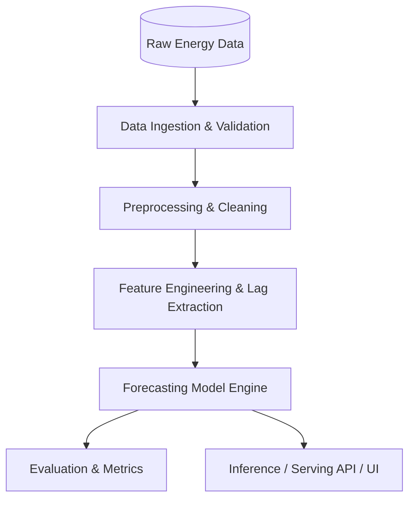

# 01. System Architecture

## Overview
*This document outlines the overall system architecture, technology stack, and high-level data & execution pipeline for the AI-Powered Energy Consumption Forecasting system.*

---

## Architecture Diagram (Placeholder)

---

## Technology Stack
- **Language**: Python 3.10+
- **Data Processing**: Pandas, NumPy, Scikit-Learn
- **Modeling**: PyTorch / LightGBM / XGBoost / Prophet (to be specified as execution starts)
- **Visualization / Dashboard**: Matplotlib, Seaborn / Streamlit
