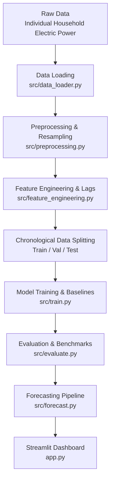

# Project Architecture

This document specifies the end-to-end architectural pipeline of the **AI-Powered Energy Consumption Forecasting** system.

---

## ️ End-to-End Pipeline Overview

The system follows a modular, decoupled data and inference pipeline designed to prevent data leakage and ensure reproducible forecasts.

---

## Pipeline Stages

### 1. Raw Data Ingestion
- **Module**: `src/data_loader.py`
- **Responsibility**: Loads raw records (`household_power_consumption.txt`) from `data/raw/` with custom delimiter handling, parses dates and times into unified UTC/local timestamps, validates schema integrity, and flags missing entries.

### 2. Preprocessing & Resampling
- **Module**: `src/preprocessing.py`
- **Responsibility**: Handles missing values (imputation, interpolation), eliminates duplicate timestamps, and resamples 1-minute measurements into hourly aggregated series (kWh energy sums and average power kW) for stable forecasting.

### 3. Feature Engineering
- **Module**: `src/feature_engineering.py`
- **Responsibility**: Generates temporal features (hour-of-day, day-of-week, month, weekend indicators, cyclical sine/cosine encodings), rolling window statistics (e.g., 24-hour moving average, standard deviation), and autoregressive lag variables (e.g., $t-1, t-2, t-24, t-168$).

### 4. Chronological Splitting
- **Principle**: Strict time-series temporal split (e.g., chronological 70% train, 15% validation, 15% test).
- **Rule**: No random shuffling, preventing future lookahead bias and temporal leakage.

### 5. Model Training & Serialization
- **Module**: `src/train.py`
- **Responsibility**: Fits baseline models and candidate machine learning estimators, tunes hyperparameters on the validation split, and serializes trained estimators to `models/`.

### 6. Model Evaluation
- **Module**: `src/evaluate.py`
- **Responsibility**: Evaluates predictions on the held-out test split using standard regression metrics ($\text{MAE}, \text{RMSE}, \text{MAPE}, R^2$) and writes benchmark summaries to `outputs/metrics/` and residual visualisations to `outputs/figures/`.

### 7. Forecast Generation
- **Module**: `src/forecast.py`
- **Responsibility**: Takes recent historical windows, executes single-step or multi-step forward horizon rollouts, and provides forecast arrays alongside prediction intervals.

### 8. Interactive Dashboard
- **Module**: `app.py`
- **Responsibility**: Provides a Streamlit web application enabling interactive parameter selection, historical visualization, forecast curve inspection, and error breakdown.
